import Figure from "@/components/Figure.astro"
import figureExample from "@/assets/black.png"


Hello!

As I mentioned in my previous article, I have decided to get back into _reverse engineering_ after spending several years away from it. To kick off this new chapter, I have chosen a relatively simple challenge that will allow us to put some basic static analysis concepts into practice.

The binary comes from crackmes.one(https://crackmes.one), a platform that hosts challenges designed to help people practice reverse engineering. In this case, we will be looking at **Hidden Flag**, created by _micky2331_.

The original challenge description reads as follows:

> The program hides a secret. Use static analysis or debugging to discover the original flag that passes validation.

The goal is to analyze the executable and uncover the hidden password that the program expects as valid input. To do so, we will examine its structure and follow the execution flow until we find the validation routine.

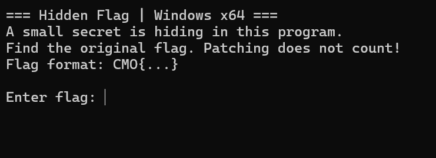

The analysis will be carried out using IDA, although the same process can be followed with other tools such as Ghidra, Binary Ninja, and so on.

The first thing we'll do is open the binary in DIE to get an initial overview of what we're dealing with.

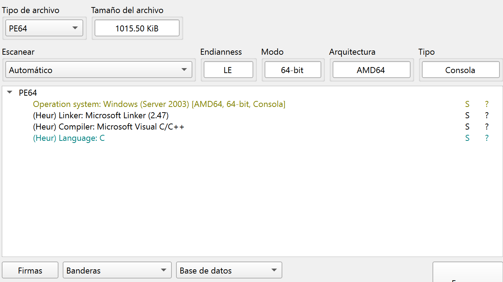

At first glance, DIE identifies the binary as being written and compiled with Visual C++. More importantly, it does not appear to use any protection mechanisms such as obfuscation or anti-debugging techniques.

However, as I mentioned earlier, we cannot always rely on what DIE reports. Sometimes binary signatures can be misleading, and what a tool identifies as one thing may turn out to be something else entirely.

With that out of the way, it's time to move on to the actual analysis and start examining the binary statically.

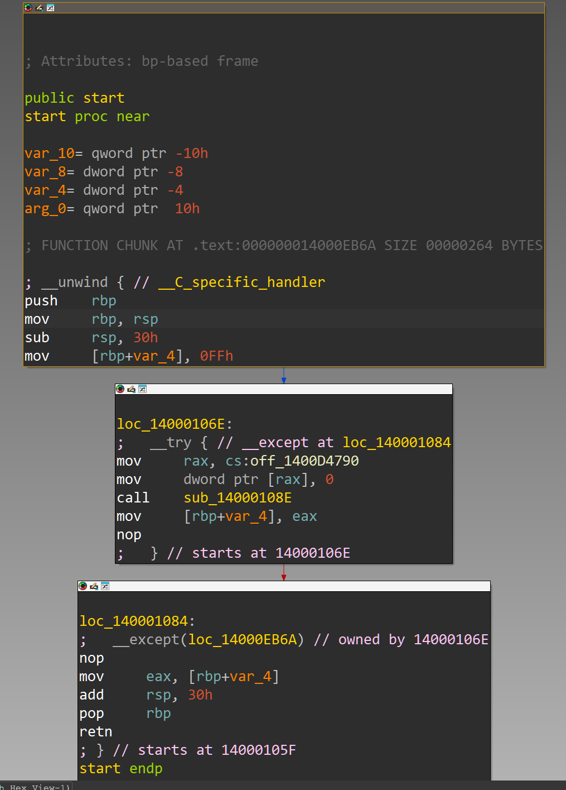

When we open the binary, IDA takes us to `start`, the program's entry point. This is the location specified by the `AddressOfEntryPoint` field in the PE header (which contains an RVA, rather than a virtual address).

It's important to understand that `start` is not the program's `main` function. In this case, it is startup code generated by the compiler and runtime. Its purpose is to prepare the execution environment before eventually calling the program's actual `main` function.

We are not going to examine this code in detail because it does not contribute to solving the challenge. Although some parts may look unusual, such as the `__try/__except` block, they are related to structured exception handling (SEH) and the way IDA reconstructs and displays this type of code. This is part of the program's startup routine.

Since the binary is not obfuscated and there are no additional protections preventing us from reaching the author's code, the quickest approach for this challenge is to start by looking for interesting strings.

This has always been part of my usual workflow: once I open a binary, one of the first things I do is look for strings that might give me some clues about what the program does and where its main functionality might be located. Before diving into anything more complex, this is often a good starting point. If the strings are readable and haven't been obfuscated, they can provide quite a lot of useful information.

In the screenshot below, we can see some of the most relevant strings found in the binary. Among them are the banner displayed when the program starts, along with the messages "Correct" and "Wrong", which tell us whether the input was accepted or rejected.

There is another detail worth mentioning. As you can see in the strings, the binary references a library called `libgcc_s_dw2-1.dll`. This is not a Microsoft Visual C++ runtime library; it is associated with the MinGW/GCC toolchain.

However, we should not draw a definitive conclusion about the compiler based on this single clue alone. We would need to examine additional information to confirm it.

Although this detail is not relevant to solving the challenge itself, it illustrates something worth keeping in mind: automated analysis tools do not always provide completely accurate information. We should review their findings and treat them as useful indicators rather than unquestionable facts.

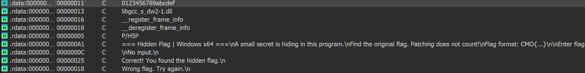

It takes us to the .rdata area, it is a section that normally contains read-only data, such as strings and constants used by the program.

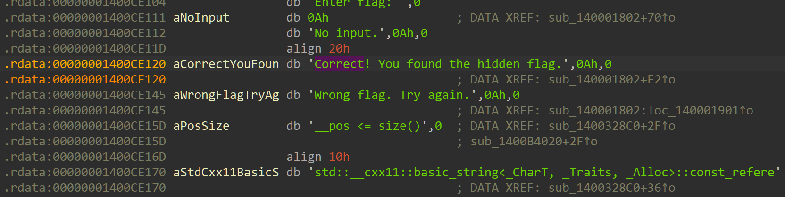

By following the string references, we eventually reach the `main` function. Here, we can see the challenge banner. Essentially, this block checks whether the input operation has failed (for example, if the end of the input stream has been reached). It then waits for us to enter the key before proceeding to the end of the `main` function, at `loc_1400018D4`.


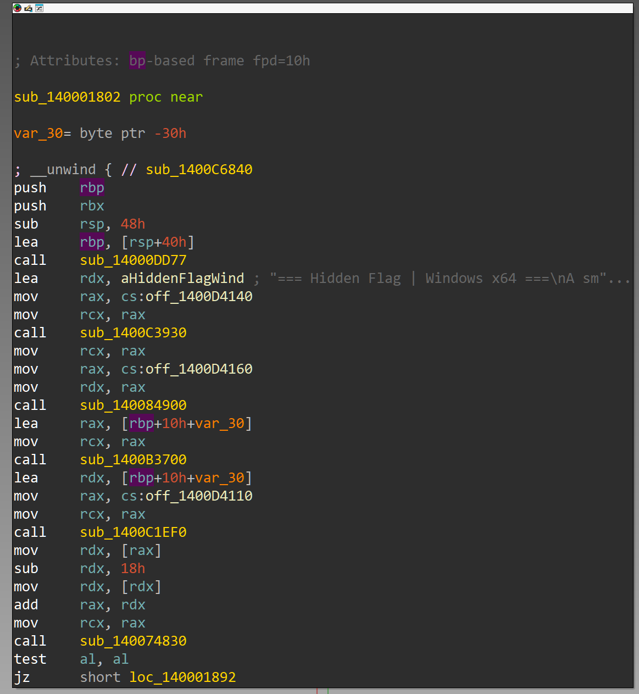


This part of `main` determines whether the entered key is valid or not. If the key is correct, the program displays "Correct". Otherwise, it displays either "Wrong" or "No Input", depending on the situation.

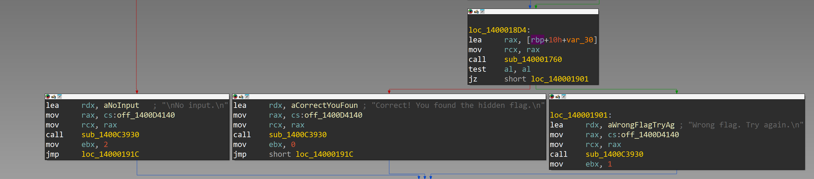


At a high level, the code below shows the reference to the "Read" string, followed by a call to **sub_140001760,** which performs the key validation. Finally, depending on the return value, the program displays either "**Wrong**" if it returns **0**, or "**Correct**" if it returns **1**.

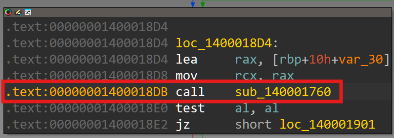


Now we're going to examine the heart of the challenge: the `sub_140001760` function. This is where the key we entered earlier is validated. The function first checks its length and then determines whether it is the correct key by performing a series of operations that we will examine in detail below.

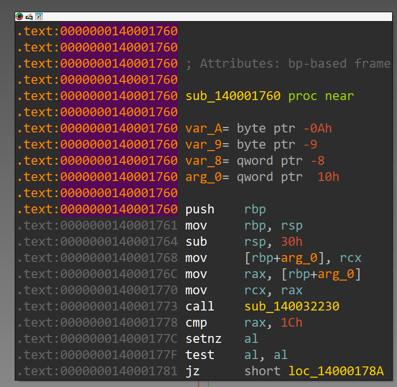


Here, the function receives the key we entered earlier and uses `cmp rax, 1Ch` to check whether its length is exactly 28 characters.

Next, `setnz al` sets **AL** to `1` if the length does not match, or to `0` if it does. The `test al, al` instruction then checks the value stored in **AL**. If it is zero, the `jz` instruction jumps to the loop initialisation, meaning the input has the correct length. Otherwise, the input is rejected, and the function returns `0`.

This check prevents the program from entering the loop when the input length is incorrect. There is no need to examine the individual characters if the key does not meet the required length in the first place. The program can reject it immediately without performing any further validation.


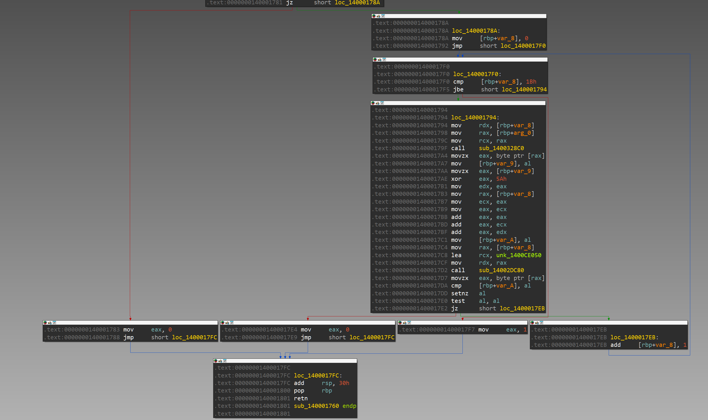
<p style="text-align:center;">Imagen Global del Bucle </p>

Now, assuming the key is exactly 28 characters long, the function proceeds to the next step: entering the loop, where a series of calculations are performed. This loop starts at `loc_140001794`.


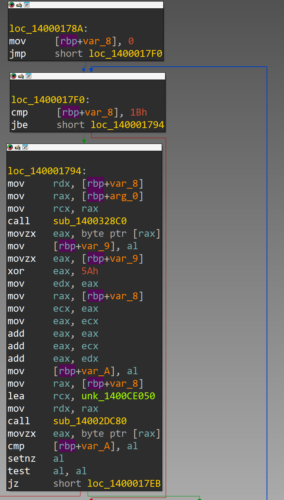

The most notable part here is the loc_140001794 block, where each letter we have entered goes through a formula. Broadly speaking, we have that var_8 is the index of the loop and we see that both **ecx** and **eax** receive the index, then we do an `add eax,eax` which is equivalent to multiplying by 2 and then we have `add eax,ecx` which adds the index again so we have 3 times the index and finally the a`dd, eax, edx` which contains the result of `XOR eax,5Ah`

Summarizing what was explained above translates into this:


$$
        result = (character \oplus 0x5A) + (3 \times index)
$$


The result is then compared with the corresponding byte in the table shown in the image below, which is stored at `unk_1400CE050`.

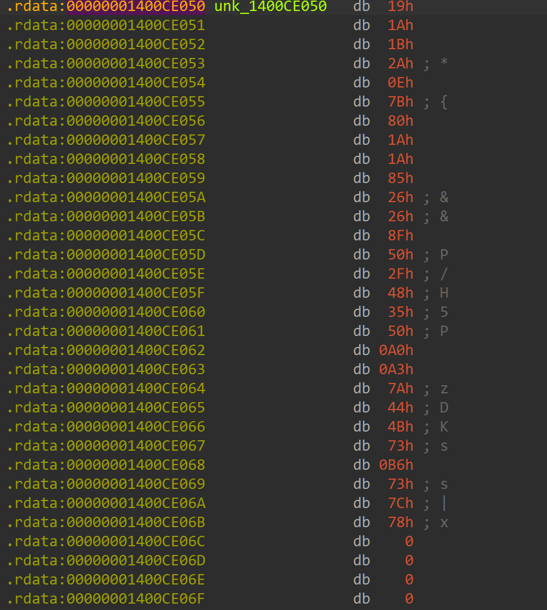


Now that we have figured out how the operations work and identified the table used to compare our input, the quickest way to extract the key is to write a small Python script.

To do this, I first navigated to the address **unk_1400CE050** in IDA and opened the Hex View window.

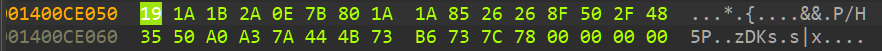

I copied the first 28 bytes of the table, which are used to compare the entered key. With those bytes and the formula we derived earlier, I wrote a small Python script to recover the flag.

```
expected_bytes = [
    0x19, 0x1A, 0x1B, 0x2A, 0x0E, 0x7B, 0x80, 0x1A, 
    0x1A, 0x85, 0x26, 0x26, 0x8F, 0x50, 0x2F, 0x48, 
    0x35, 0x50, 0xA0, 0xA3, 0x7A, 0x44, 0x4B, 0x73, 
    0xB6, 0x73, 0x7C, 0x78
]

flag = ""
for i in range(28):
    char_val = (expected_bytes[i] - (3 * i)) ^ 0x5A
    flag += chr(char_val & 0xFF)

print("Flag encontrada:", flag)
```


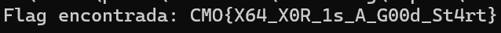

We apply the flag obtained

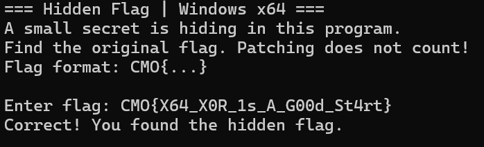

And with that, we've solved the challenge.

Thanks for reading it!

